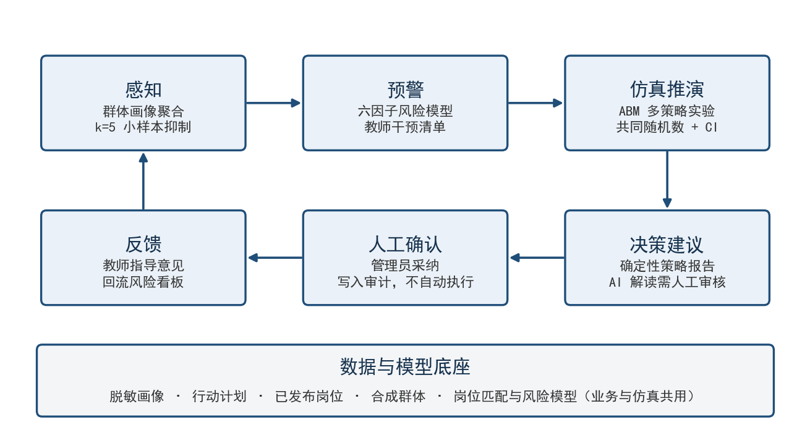
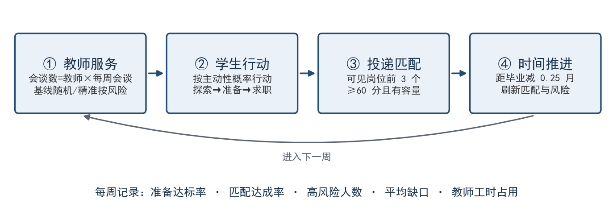

# 职途智航 · 高校毕业生就业治理智能体

职途智航是一个面向高校的就业服务与就业治理系统，服务学生、就业指导教师和就业管理员三类角色。

- **个体服务**：学生维护职业画像，系统基于可追溯来源的岗位数据给出可解释的岗位匹配、能力缺口和求职行动计划，教师在授权范围内给出指导意见。
- **群体治理**：在个体服务之上增加风险预警、群体画像、多智能体（ABM）策略仿真和策略报告，按“感知 → 预警 → 仿真推演 → 决策建议 → 人工确认 → 反馈”闭环运行。

设计原则是**模型辅助、人工决策**：岗位匹配与风险分由确定性规则计算，每一分可追溯；策略效果先在仿真中推演并给出置信区间；大模型（SF-FastGPT）只负责问答与文字解读，不产生任何数字；所有决定由教师或管理员做出，系统不自动给学生发消息或修改计划。



## 功能介绍

### 学生端

| 功能 | 说明 |
|:---|:---|
| 注册与登录 | 学生自助注册；三类角色共用登录入口，按角色进入不同工作台；支持修改密码 |
| 职业画像 | 维护专业、技能、项目经历、目标岗位、目标城市和求职阶段 |
| 岗位推荐 | 按五维规则计算匹配分（技能 50、专业 20、项目 15、目标岗位 10、城市 5），返回分项得分、能力缺口和岗位来源 |
| 行动计划 | 基于所选岗位的真实缺口生成可执行的求职任务清单 |
| 指导意见 | 查看授权教师给出的意见正文与时间 |
| 就业咨询 | 通过 SF-FastGPT 的职业发展、就业政策两条工作流问答；有来源时显示来源链接，无来源时提示人工确认 |

岗位数据来自项目登记的模拟岗位和公开岗位快照（`docs/data-governance/`），只有已发布、未过期且有来源的岗位参与匹配。匹配结果不构成录用承诺。

### 教师端（就业指导教师）

| 功能 | 说明 |
|:---|:---|
| 授权学生 | 只能看到管理员授权给自己的学生，看不到学号与联系方式 |
| 学生摘要 | 查看授权学生的画像摘要、最佳匹配与行动计划状态 |
| 指导意见 | 为学生提交意见，写入脱敏审计 |
| 风险预警 | 按就业准备度风险分从高到低排列授权学生，展开可看到六个因子的得分拆解和对应干预建议 |

### 管理员端（就业管理员）

| 功能 | 说明 |
|:---|:---|
| 权限配置 | 创建教师账号（首次登录须改密）、重置密码、启用/停用账号、配置教师可见的学生 |
| 岗位资料 / 知识资料 | 查看岗位与知识库来源台账 |
| 脱敏审计 | 查看关键操作记录（角色、动作、资源、时间），不含画像正文或密钥 |
| 群体画像 | 按专业 × 求职阶段聚合就业准备度分布；分组少于 5 人时合并或隐藏；可在真实数据与合成数据之间切换 |
| 策略仿真 | 设置群体规模、仿真周数、教师人数、岗位供给比例等参数，对比多种治理策略的逐周曲线和终点指标（含 95% 置信区间） |
| 策略报告 | 后端生成确定性报告，置信区间重叠的策略如实写“差异不显著”；可选大模型解读并标注“需人工审核” |
| 采纳留痕 | 管理员采纳某一策略只写入审计记录，不触发任何自动操作 |

## 核心模型

### 可解释风险模型

风险分为六个因子相加，满分 100：

| 因子 | 满分 | 计分规则 |
|:---|:---:|:---|
| 画像完整度 | 25 | 无画像 25；技能少于 3 项或无项目 10 |
| 岗位匹配 | 25 | 最高匹配分 ≥ 70 为 0；50–69 为 12；< 50 为 25 |
| 技能缺口 | 15 | min(15, 5 × 最佳岗位缺口技能数) |
| 求职阶段 | 20 | 探索期且距毕业 ≤ 12 个月 20；准备期且 ≤ 6 个月 12 |
| 行动计划 | 10 | 尚未生成行动计划 10 |
| 画像时效 | 5 | 超过 30 天未更新 5 |

R ≥ 60 为高风险，35 ≤ R < 60 为中风险，R < 35 为低风险。模型是纯函数，输入不含性别、籍贯、家庭、健康、民族、政治面貌等受保护属性，也不含学号和联系方式。实现见 `backend/app/services/risk.py`。

### 多智能体仿真（ABM）

- **主体**：合成学生（专业、技能、项目、目标岗位与城市，以及学习率 λ、主动性 θ、城市弹性 φ）、教师（每周可用会谈数）、岗位市场（按供给比例设定容量）。
- **周推进**：教师服务 → 学生行动（学习缺口技能、推进求职阶段）→ 投递匹配 → 城市可见性 → 时间推进并更新风险分。
- **业务与仿真同源**：仿真评分器与线上 `MatchingService` 在 500 组随机样本上逐分一致，风险更新直接调用业务风险模型，所以仿真里的“达标”“高风险”与教师看到的是同一口径。
- **治理策略**：现状基线、技能补强培训、精准帮扶（按风险分配教师时间）、岗位精准推送（跨城市可见）、组合策略。每种策略只改动模型中的一条规则。
- **统计方法**：共同随机数（各策略使用同一批合成学生和随机流）、多次重复、95% 置信区间；两策略区间不重叠才判定差异显著。



默认情景（300 名合成学生、16 周、10 次重复）的终点结果：

| 策略 | 匹配达成率（95% CI） | 较基线 | 高风险人数（95% CI） |
|:---|:---|:---|:---|
| 现状基线 | 53.4%（51.6–55.2） | — | 6.7（5.0–8.4） |
| 技能补强培训 | 55.5%（53.6–57.4） | +2.1 个百分点，不显著 | 2.6（1.4–3.8），显著下降 |
| 精准帮扶 | 53.2%（51.2–55.2） | −0.2 个百分点，不显著 | 2.9（2.0–3.8），显著下降 |
| 岗位精准推送 | 56.7%（55.4–58.0） | +3.3 个百分点，显著 | 3.6（2.5–4.7），显著下降 |

结论：要提高整体匹配率，优先推送岗位信息；要减少掉队学生，采用精准帮扶或技能培训。完整数据与敏感性分析见 `docs/deliverables/simulation-sensitivity.md`。

> 以上结果基于合成群体与规则模型，用于比较策略之间的相对效果，不代表真实就业预测；行为参数尚未用真实数据校准。

### 模型检验

以下检验都写成了自动化测试（`backend/tests/test_simulation.py`），每次运行测试时都会执行：

| 检验 | 判据 |
|:---|:---|
| 等价性：仿真评分器 vs 业务 `MatchingService`，500 组样本 | 分数完全一致 |
| 确定性：相同参数与种子运行两次 | 全部输出逐字段相等 |
| 极端条件：岗位供给比例为 0 | 匹配达成率恒为 0 |
| 极端条件：教师数为 0 | 精准帮扶与基线结果完全相同 |
| 性能：默认参数 4 策略 × 10 次重复 | 10 秒内完成 |

## 技术栈

| 层 | 技术 |
|:---|:---|
| 前端 | React 18、TypeScript、Vite；图表为原生 SVG，未引入图表库 |
| 后端 | Python 3.13、FastAPI、SQLAlchemy 2、Alembic |
| 数据库 | PostgreSQL（驱动 psycopg 3） |
| 大模型 | SF-FastGPT，由服务端调用；开发时可使用 `mock` 模式 |
| 仿真 | 纯 Python 实现，无额外依赖 |

## 目录结构

```text
backend/
  app/
    api/          路由：auth、admin_accounts、career、staff、governance
    services/     业务逻辑：matching、risk、insights、career、assistant、audit
      simulation/ ABM 仿真：cohort（合成群体）、scoring、engine、report
    clients/      SF-FastGPT 客户端
    models/       ORM 实体
  alembic/        数据库迁移
  scripts/        运维与实验脚本
  tests/          后端测试
frontend/
  src/            学生端 App、教师/管理员端 StaffDashboard
    components/governance/  风险预警、群体画像、策略仿真、策略报告
docs/
  specs/          需求、架构与任务文档
  data-governance/ 岗位数据与学生画像边界
  knowledge-base/ 知识库资料与回答约束
  deliverables/   比赛材料、仿真结果与插图
tools/            比赛文档生成脚本
```

## 本地运行

### 环境要求

- Python 3.13
- Node.js 20 或更高版本
- PostgreSQL（已创建空数据库）

### 1. 配置环境变量

```powershell
copy .env.example .env
```

至少填写以下变量：

| 变量 | 说明 |
|:---|:---|
| `DATABASE_URL` | 格式为 `postgresql+psycopg://用户名:密码@主机:端口/数据库名` |
| `ADMIN_BOOTSTRAP_USERNAME` / `ADMIN_BOOTSTRAP_PASSWORD` | 首个管理员账号，仅在运行 `bootstrap_admin` 时使用 |
| `DEMO_ACCOUNT_PASSWORD` | 可选，演示教师与演示学生共用的密码，仅在运行 `seed_governance_demo` 时使用 |
| `FASTGPT_MODE` | `mock`（默认，不调用外部服务）或 `sf_fastgpt` |

切换到 `sf_fastgpt` 时，还需填写 `FASTGPT_BASE_URL`、`FASTGPT_API_KEY_CAREER`、`FASTGPT_API_KEY_POLICY` 和两个工作流 ID。

### 2. 启动后端

```powershell
cd backend
python -m venv .venv
.\.venv\Scripts\Activate.ps1
pip install -r requirements.txt
alembic upgrade head
python -m scripts.bootstrap_admin          # 创建首个管理员
python -m scripts.seed_governance_demo     # 可选：创建演示教师 demo_teacher 和 6 名合成学生
uvicorn app.main:app --reload --port 8000
```

访问 `http://127.0.0.1:8000/health` 检查服务状态和当前 FastGPT 模式；接口文档在 `http://127.0.0.1:8000/docs`。

在 Windows 上，如果启动时报 `WinError 10013`，说明端口 8000 已被占用或在系统保留的端口段内。换一个端口启动即可，例如 `--port 8001`，同时让前端指向新端口（见下一节）。

### 3. 启动前端

```powershell
cd frontend
npm install
npm run dev
```

访问 `http://127.0.0.1:5173`。开发服务器会把 `/api` 请求代理到 `http://127.0.0.1:8000`；后端使用其他端口时，启动前端前先设置代理地址：

```powershell
$env:VITE_API_PROXY="http://127.0.0.1:8001"
npm run dev
```

### 4. 登录

- **管理员**：使用 `.env` 中设置的 `ADMIN_BOOTSTRAP_USERNAME` 和 `ADMIN_BOOTSTRAP_PASSWORD`。
- **演示教师**：用户名 `demo_teacher`，密码为 `DEMO_ACCOUNT_PASSWORD`。
- **学生**：在登录页自助注册。
- **其他教师**：由管理员在“权限配置”页面创建。

## 测试与检查

```powershell
# 后端
cd backend
pip install pytest
python -m pytest -q
ruff check .

# 前端
cd frontend
npm run lint
npm run build
```

## 脚本

在 `backend` 目录下以 `python -m scripts.<名称>` 运行：

| 脚本 | 用途 |
|:---|:---|
| `bootstrap_admin` | 创建首个管理员；已存在管理员时不做任何修改 |
| `seed_governance_demo` | 创建演示教师和 6 名合成学生（覆盖高、中、低风险），可重复运行 |
| `simulation_sensitivity` | 运行四策略对比和单因素敏感性分析，输出到 `docs/deliverables/simulation-sensitivity.{md,json}` |
| `collect_public_jobs` | 从公开渠道采集有边界、可复核的岗位快照 |
| `verify_fastgpt` | 检查两条 SF-FastGPT 工作流的连通性，输出中不含凭据 |

## 接口概览

全部接口以 `/api/v1` 为前缀，按角色鉴权，越权访问返回 403。完整定义见运行时的 `/docs`。

| 分组 | 主要接口 |
|:---|:---|
| 认证 | `POST /auth/register/student`、`POST /auth/login`、`POST /auth/change-password` |
| 学生 | `GET/PUT /career-profile/me`、`POST /matches`、`POST /action-plans`、`GET /action-plans/latest`、`POST /assistant/query` |
| 教师 | `GET /staff/counselor/students`、`POST /staff/counselor/advice`、`GET /governance/counselor/risks` |
| 管理员 · 账号 | `POST /admin/users/teachers`、`POST /admin/users/{id}/reset-password`、`PATCH /admin/users/{id}/status`、`POST /staff/admin/counselor-access`、`GET /staff/admin/overview` |
| 管理员 · 治理 | `GET /governance/admin/insights`、`GET /governance/admin/simulations/defaults`、`POST/GET /governance/admin/simulations`、`GET /governance/admin/simulations/{id}`、`POST /governance/admin/simulations/{id}/report`、`POST /governance/admin/simulations/{id}/adopt`、`GET /governance/admin/datasets/synthetic.csv` |

## 隐私与安全

- **最小数据**：不保存简历原文；治理接口不返回学号与联系方式；仿真只使用编号为 `syn-i` 的合成学生，与真实账号无关联。
- **小样本抑制**：群体画像中少于 5 人的分组合并或隐藏，不返回个人记录。
- **权限边界**：教师只能访问已授权的学生；管理员功能单独鉴权。
- **审计最小化**：只记录角色、动作、资源类型和时间，不记录画像正文、密钥或数据库连接串。
- **密钥只在服务端**：FastGPT API Key 只由后端读取，大模型不直接访问业务数据库；外部服务不可用时降级为确定性结果。
- **仅辅助指导**：风险分和匹配结果只用于辅助就业指导，不作为评价或处分依据，也不构成录用承诺。

请勿向仓库提交 `.env`、真实学生信息、企业联系人、学校生产系统凭据或 SF-FastGPT 密钥。

## 文档

| 文档 | 位置 |
|:---|:---|
| 就业治理智能体需求与架构 | `docs/specs/governance-agent-product.md`、`docs/specs/governance-agent-architecture.md` |
| 仿真作品方案书 | `docs/deliverables/04-仿真作品方案书.md` |
| 仿真敏感性分析结果 | `docs/deliverables/simulation-sensitivity.md` |
| 学生画像数据边界 | `docs/data-governance/student-profile-boundaries.md` |
| 知识库回答约束 | `docs/knowledge-base/response-guardrails.md` |
