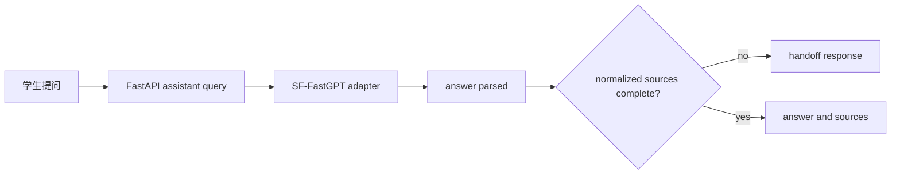

# 修复设计 (Bugfix Design)

> **问题名称：** SF-FastGPT 回答被错误降级为人工确认建议
> **关联规范：** `docs/specs/bugfix-fastgpt-source-fallback.md`
> **版本：** v1.0
> **状态：** 草稿
> **最后更新：** 2026-09-11

## 1. 根因分析

### 1.1 初始假设

- 前端代理、认证或 API 端口导致请求未到达 FastGPT。

### 1.2 确认后的根因

- 官方诊断已确认两条路由都以 `sf_fastgpt` 模式完成上游调用，排除前端路由和平台不可达。
- `FastGPTClient` 能解析回答文本；其来源解析只支持三个固定位置。`AssistantService` 对空来源强制调用 `handoff_response`，因此原回答不会进入 API 响应。
- 最小脱敏结构诊断已确认：即使请求 `detail: true`，两条路由的 `responseData` 均为空，`choices[0].message` 只包含 `role` 和 `content`。当前工作流没有把引用作为 API 输出，不能通过扩展字段映射解决。

### 1.3 触发条件

- 工作流不输出标题、链接、版本/日期，或输出结构不在当前来源解析器支持范围内。

## 2. 代码路径与影响面

| 组件 / 文件 | 角色 | 是否修改 |
|:---|:---|:---|
| `backend/app/clients/fastgpt.py` | 请求、文本与来源归一化 | 是 |
| `backend/app/services/assistant.py` | 来源安全门槛 | 仅在保持门槛的前提下评估 |
| `backend/tests/` 中 FastGPT 适配器测试 | 响应映射与降级回归 | 是 |
| `frontend/src/` | 消费既有 API 合同 | 否，除非证据表明当前来源渲染有错误 |

### 2.3 明确不修改的区域

- 数据库、RBAC、会话、岗位匹配和行动计划。
- 前端直连 FastGPT 或向浏览器下发任何平台凭据。

## 3. 修复策略

### 3.1 最小安全修复方案

1. 由平台工作流所有者配置知识库引用输出，使 Chat Completions 响应包含可审核的结构化来源；每条必须有标题、URL、版本/日期。
2. 取得不含回答正文和凭据的字段结构。若该结构不在现有映射范围内，再在 `normalize_sources` 中增加最小映射。
3. 保持 `AssistantService` 的空来源转人工逻辑不变。
4. 用固定脱敏夹具覆盖成功映射、缺字段降级和 HTTP/格式异常降级。

这是最小方案，因为它先让平台提供实际可审核信息，仅在确有新增字段时才扩展响应归一化；不改变浏览器 API、权限边界或可信来源要求。

### 3.2 被否决的备选方案

| 方案 | 放弃原因 |
|:---|:---|
| 删除空来源降级 | 会违反可追溯性约束，并可能展示未经核验的就业建议。 |
| 前端直接调用平台 | 会暴露服务端密钥与应用配置，并绕过统一安全控制。 |
| 把任意回答文本当作来源 | 无法提供标题、链接和版本/日期，不能支持审核。 |

## 4. 测试与验证策略

### 4.1 复现证明

- 保留当前 `scripts.verify_fastgpt` 两路输出，证明真实调用时来源数为零。
- 新增脱敏响应夹具，证明已解析回答但无法识别来源时会进入 handoff。

### 4.2 修复证明

- 对工作流的真实脱敏来源结构写定向单元测试，断言输出完整的统一来源和原回答。
- 仅在两路诊断都报告完整来源且通过时，接受真实平台联调成功。

### 4.3 回归防护

- 测试无来源、来源缺 URL、来源缺版本/日期、网络异常和响应缺回答，均保持人工确认建议。

## 5. 风险与发布计划

| 风险 | 缓解措施 | 监控方式 |
|:---|:---|:---|
| 平台响应结构变化 | 将解析限制在明确记录的字段并以夹具覆盖 | 运行两路诊断 |
| 无来源内容被展示 | 保持服务层安全门槛 | 断言 `handoff_recommended` |
| 凭据泄露 | 不记录原始响应、请求头或环境变量 | 代码审查与诊断输出范围 |

### 发布 / 回滚说明

- **发布方式：** 正常后端发布，前端无合同变化。
- **回滚条件：** 来源映射产生不完整或错误来源，或任一路由不再通过诊断。
- **回滚步骤：** 回退适配器映射；安全降级会继续生效。

## 6. 审批记录

| 日期 | 审批人 | 决定 | 备注 |
|:---|:---|:---|:---|
| — | — | 待审查 | — |
