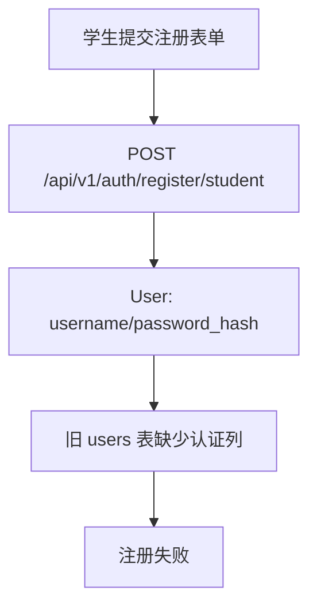

# 学生注册迁移遗漏修复设计

> **问题名称：** 认证迁移未应用导致学生注册失败
> **关联规范：** `docs/specs/bugfix-student-registration-migration.md`
> **版本：** v1.0
> **状态：** 审查中
> **最后更新：** 2026-09-09

## 1. 根因分析

当前运行进程已加载 `app.api.auth`，而数据库 `users` 表未包含该模块依赖的认证列。`backend/alembic/versions/20260909_0004_account_authentication.py` 尚未对该数据库执行。

## 2. 代码路径与影响面

受影响组件：运行数据库 schema。认证 API、前端表单和 ORM 定义不修改。

## 3. 修复策略

使用运行服务的 `backend/.venv/Scripts/alembic.exe` 执行 `upgrade head`。该方案复用已审查的迁移，避免手写 SQL 或绕过认证字段。

不采用手动 `ALTER TABLE`，因为会绕过 password reset 表、约束和现有数据迁移逻辑。

## 4. 验证策略

1. 执行 `alembic current` 和 `alembic upgrade head`。
2. 只读确认 `users` 认证列和 `password_reset_tokens` 表。
3. 使用一次唯一测试账号调用学生注册接口，预期 `201`；仅在注册成功后报告创建的测试账号。
4. 用该账号执行登录，预期 `200`，证明 password hash 和新 schema 联通。

## 5. 发布与回滚

- **发布方式：** 对本地运行数据库执行一次迁移。
- **回滚条件：** 迁移报错或核心表数据约束无法满足。
- **回滚步骤：** 停止，保留报错；未经用户确认不执行 downgrade。

## 6. 审批记录

| 日期 | 审批人 | 决定 | 备注 |
|:---|:---|:---|:---|
| 2026-09-09 | — | 待批准 | 等待执行迁移授权 |
