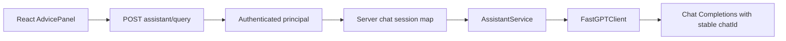

# 架构设计 (Architecture Specification)

> **功能名称：** Web 端复用 FastGPT 连续会话
> **版本：** v1.0
> **状态：** 草稿
> **关联需求：** `docs/specs/fastgpt-conversation-parity-product.md`
> **最后更新：** 2026-09-11

## 1. 系统概览

在后端进程内新增受控的会话标识存储。API 层从已认证 principal 得到用户 UUID，并按 `(user_id, consultation_type)` 获取或生成随机 `chatId`；该标识只传给服务端 FastGPT 客户端，不返回浏览器。FastGPT 客户端继续发送最小画像上下文，AssistantService 继续处理无来源安全提示。

### 架构决策记录 (ADR)

| 决策 | 选择方案 | 被否定方案 | 理由 |
|:---|:---|:---|:---|
| 会话归属 | 服务端按用户 UUID 和路由存储 | 浏览器自行提交 chatId | 防止跨用户伪造或串线 |
| 存储位置 | 进程内内存 | PostgreSQL 持久化 | 测试页式上下文无需长期留存，避免新增隐私数据 |
| API 合同 | 请求/响应 JSON 不变 | 新增 chatId 字段 | 会话是服务端实现细节 |

## 2. 组件拓扑图



## 3. 数据模型

不新增数据库表或字段。内存映射键和值：

```text
(principal.user_id, AssistantRoute) -> opaque random chatId
```

会话映射在进程重启时清空，并可在用户登出或会话撤销时清理。

## 4. API / 接口签名

`POST /api/v1/assistant/query` 请求和响应 schema 保持不变。后端内部调用可增加 `chat_id` 参数，但该参数不出现在浏览器 API。

## 5. 依赖白名单

| 依赖名 | 版本 | 用途 | 是否新增 |
|:---|:---|:---|:---|
| Python `uuid`、`threading` | 标准库 | 生成与保护会话标识 | 否 |
| FastAPI / SQLAlchemy | 现有依赖 | 获取认证用户和处理请求 | 否 |

## 6. 错误处理策略

| 场景 | 处理方式 |
|:---|:---|
| 首次咨询 | 生成该用户/路由专属会话标识 |
| 连续咨询 | 复用对应会话标识 |
| 用户会话撤销 | 删除该用户的内存会话映射 |
| FastGPT 异常或无回答 | 保持既有人工确认降级 |
| 无来源但有回答 | 保留回答并标记人工确认 |

## 7. 安全策略

- 会话标识不返回前端、不写入审计正文或日志。
- 映射只使用服务端已认证的用户 UUID，客户端不能指定其他用户。
- 职业与政策路由始终使用不同的会话命名空间。
- 不新增学生身份字段或聊天正文持久化。

## 8. 性能考量

| 指标 | 目标值 | 测量方式 |
|:---|:---|:---|
| 上游请求次数 | 每个问题 1 次 | FastGPT 客户端测试 |
| 会话查找 | O(1) | 内存映射单元测试 |
| 额外持久化 | 0 次 | API 路径测试 |

## 9. 审批记录

| 日期 | 审批人 | 决定 | 备注 |
|:---|:---|:---|:---|
| — | — | 待审查 | — |
