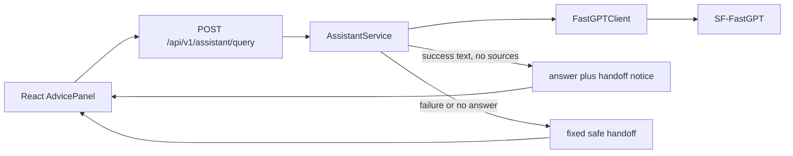

# 架构设计 (Architecture Specification)

> **功能名称：** 展示无结构化来源的 SF-FastGPT 回答
> **版本：** v1.0
> **状态：** 已批准
> **关联需求：** `docs/specs/fastgpt-unverified-answer-display-product.md`
> **最后更新：** 2026-09-11

## 1. 系统概览

修改仅位于后端 `AssistantService` 的来源门槛分支。成功的 SF-FastGPT 回答在来源为空时不再被替换；服务将其标记为需要人工确认，并提供特定免责声明。请求失败、无回答和模拟模式继续使用 `handoff_response`。API 模型和前端数据类型不变。

### 架构决策记录 (ADR)

| 决策 | 选择方案 | 被否定方案 | 理由 |
|:---|:---|:---|:---|
| 无来源真实回答 | 保留文本并强制人工确认 | 丢弃文本或伪造来源 | 满足用户展示需求，不把内容冒充为已审核资料 |
| 适用范围 | 仅 `sf_fastgpt` 成功响应 | 所有模式统一放行 | 模拟、失败和无回答不具有可展示的上游文本 |
| API 合同 | 不增加字段 | 新增来源状态字段 | 既有 `sources`、`disclaimer` 与 `handoff_recommended` 已表达该状态 |

## 2. 组件拓扑图



## 3. 数据模型

不新增数据库实体、迁移或持久化字段。复用 `AssistantResponse`：

| 字段 | 无来源真实回答的值 |
|:---|:---|
| `answer` | SF-FastGPT 返回的非空文本 |
| `sources` | 空数组 |
| `disclaimer` | 平台未返回可核验来源，请人工确认 |
| `handoff_recommended` | `true` |
| `mode` | `sf_fastgpt` |

## 4. API / 接口签名

`POST /api/v1/assistant/query` 的请求和响应 schema 不变。无来源真实回答的示例：

```json
{
  "answer": "SF-FastGPT 返回的文本",
  "sources": [],
  "disclaimer": "平台未返回可核验来源，请人工确认。",
  "handoff_recommended": true,
  "mode": "sf_fastgpt"
}
```

## 5. 依赖白名单

| 依赖名 | 版本 | 用途 | 是否新增 |
|:---|:---|:---|:---|
| Python dataclasses | 标准库 | 基于已有响应构造安全提示 | 否 |
| FastAPI / Pydantic | 现有依赖 | 保持 API 合同 | 否 |

## 6. 错误处理策略

| 错误场景 | 处理方式 | 用户感知 |
|:---|:---|:---|
| SF-FastGPT 成功但无来源 | 保留原回答并设人工确认标识 | 可见建议与免责声明 |
| 上游 HTTP/格式异常 | 既有 `handoff_response` | 固定人工确认建议 |
| 响应缺少回答 | 既有 `handoff_response` | 固定人工确认建议 |
| mock 模式 | 既有 `handoff_response` | 模拟模式人工确认建议 |

## 7. 安全策略

- FastGPT API Key、应用 ID、请求头和原始响应仍只保留在服务端调用过程，禁止返回或记录。
- `sources=[]` 必须保持为空，不能从回答文本推断、生成或伪造来源。
- `handoff_recommended=true` 与免责声明为无来源内容提供显式人工复核边界。

## 8. 性能考量

| 指标 | 目标值 | 测量方式 |
|:---|:---|:---|
| 额外上游调用 | 0 | 适配器测试中的请求次数 |
| 额外数据库操作 | 0 | API 路径审查 |
| 响应延迟增量 | 可忽略 | 定向 API 测试 |

## 9. 审批记录

| 日期 | 审批人 | 决定 | 备注 |
|:---|:---|:---|:---|
| 2026-09-11 | 用户 | 批准 | 采用保留真实回答、强制人工确认标识的方案。 |
