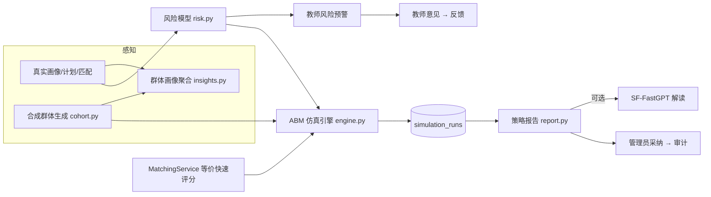

# 就业治理智能体架构设计

> **关联需求：** `governance-agent-product.md`
> **最后更新：** 2026-10-16
> **原则：** 不新增后端第三方依赖；仿真与业务共用同一套匹配和风险模型；大模型只负责解读，不产生数字。

## 1. 总体结构



新增文件：

```text
backend/app/services/risk.py                 # 纯函数风险模型
backend/app/services/insights.py             # 聚合 + 小样本抑制
backend/app/services/simulation/__init__.py
backend/app/services/simulation/cohort.py    # 合成学生 + 岗位市场
backend/app/services/simulation/scoring.py   # 与 MatchingService 等价的预计算评分器
backend/app/services/simulation/engine.py    # 智能体、逐周推进、多方案多重复
backend/app/services/simulation/report.py    # 确定性策略报告
backend/app/api/governance.py                # 新路由，在 main.py 注册
backend/alembic/versions/20261016_0007_simulation_runs.py
backend/scripts/simulation_sensitivity.py    # 敏感性分析，输出 markdown 表供方案书使用
backend/tests/test_risk.py / test_simulation.py / test_governance_api.py
frontend/src/components/governance/{RiskPanel,InsightsPanel,SimulationPanel,SimulationCharts,StrategyReport}.tsx
```

## 2. 风险模型 `risk.py`

输入是纯数据类 `RiskInput`，不使用 ORM 对象，这样真实学生和仿真智能体可以共用：

```python
@dataclass(frozen=True)
class RiskInput:
    has_profile: bool
    skill_count: int
    project_count: int
    job_stage: JobStage | None
    best_match_score: int | None      # 对当前已发布岗位实时计算的最高分
    best_match_gap_count: int
    best_match_gaps: tuple[str, ...]
    has_plan: bool
    days_since_update: int | None
    months_to_graduation: int | None  # enrollment_year + 4 年的 7 月 1 日；未知为 None
```

因子权重合计 100：

| 因子 key | 满分 | 规则 |
|:---|:---|:---|
| `profile` | 25 | 无画像 25；技能少于 3 项或无项目 10；否则 0 |
| `match` | 25 | 最高分 ≥70 为 0；50–69 为 12；低于 50 或无匹配为 25 |
| `gap` | 15 | `min(15, 5 × best_match_gap_count)` |
| `stage` | 20 | exploring 且距毕业 ≤12 个月为 20；preparing 且 ≤6 个月为 12；毕业时间未知但处于 exploring 为 10；否则 0 |
| `plan` | 10 | 没有任何行动计划为 10 |
| `stale` | 5 | 画像超过 30 天未更新为 5 |

等级：≥60 为 `high`，35–59 为 `medium`，低于 35 为 `low`。每个非零因子对应一条原因和一条建议干预：

| 因子 | 建议干预 |
|:---|:---|
| profile | 提醒完善职业画像 |
| match | 组织岗位方向咨询 |
| gap | 推荐技能补强资源：{前 3 个缺口} |
| stage | 安排一对一生涯面谈 |
| plan | 督促生成行动计划 |
| stale | 跟进近况 |

对外函数是 `assess_risk(inp: RiskInput) -> RiskAssessment(score, level, factors: dict[str,int], reasons: list[str], actions: list[str])`，另提供 `build_risk_input(session, user, as_of)`。真实学生的匹配分通过 `MatchingService` 对已发布岗位实时计算，不读取历史 `match_results`。要求是 `RiskInput` 中不出现任何敏感字段，测试需要校验它的字段集合。

## 3. 多智能体仿真模型（核心）

### 3.1 合成群体与岗位市场 `cohort.py`

- 岗位模板：复用 `docs/data-governance/mock-job-postings.csv` 和 `public-job-postings.csv`，只读取 `published` 状态，转换成 `JobTemplate(title, city, required_skills, preferred_majors, project_signals)`。每个模板的容量为 `ceil(cohort_size × supply_ratio / 模板数)`，`supply_ratio` 默认 0.8。
- 合成学生 `StudentAgent`，用 `random.Random(seed)` 生成：
  - `major`：从岗位模板的 `preferred_majors` 并集（去掉“不限”）中均匀抽取；
  - `skills`：初始技能数为 2–5，60% 来自与本专业相关的岗位技能池，40% 来自全局技能池；
  - `projects`：0–2 条，从相关岗位的 `project_signals` 中抽取；
  - `target_role`、`target_city`：从岗位模板中抽取，`city_flex ~ U(0,1)`；
  - `learning_rate ~ U(0.15, 0.45)`，`initiative ~ U(0.3, 0.9)`；
  - `stage`：exploring 50% / preparing 35% / applying 15%；
  - `months_to_graduation_start` = 仿真开始时距毕业的月数，默认 10。
- 智能体 id 统一为 `syn-{index}`，与真实账号没有任何关联。

### 3.2 评分 `scoring.py`

用 `MatchingService` 直接逐周对所有岗位评分太慢：默认参数下是 19.2 万个“学生·周”乘以岗位数，达到数百万次评分。因此实现 `FastScorer`：
- 预先把岗位模板的归一化技能集合、专业集合、项目信号词表计算好；
- 计分规则和权重直接引用 `matching.py` 中的常量 `SKILL_WEIGHT` 等，不另写一套数值；
- 每个学生缓存最佳匹配，只有技能、阶段或城市弹性变化时才重算（dirty 标记）；
- **等价性测试**：随机生成 500 组画像和岗位，`FastScorer` 的分数必须与 `MatchingService` 完全一致。

### 3.3 逐周推进 `engine.py`

每周执行以下步骤，顺序固定，确定性只依赖 seed：

1. **教师服务**：可用会话数 = `counselor_count × sessions_per_week`，默认 4 × 8。分配对象由策略决定：基线随机选取，“精准帮扶”选风险分最高者。被服务的学生 `initiative += 0.15`（上限 1.0）；处于 exploring 的直接进入 preparing。
2. **学生行动**：概率为 `initiative`。
   - exploring 状态：以 0.3 的概率进入 preparing；
   - preparing 状态：以 `learning_rate`（参加技能培训的再加 `training_boost`）习得目标岗位缺口中的 1 项技能；最佳匹配分 ≥ 60 时进入 applying；
   - applying 状态：投递最佳匹配的前 3 个岗位，分数 ≥ 60 且仍有容量时，记为“匹配达成”`matched=True`，该岗位容量减 1。
3. **时间推进**：`months_to_graduation` 每周减少 0.25；更新风险分（复用 `assess_risk`）。

可见岗位：默认只看 `target_city` 中的岗位，概率 `city_flex` 下可看全部城市。“岗位精准推送”策略让所有学生都能看到全部城市的岗位。

### 3.4 治理策略（场景）

| key | 名称 | 参数改变 |
|:---|:---|:---|
| `baseline` | 现状基线 | 教师随机服务 |
| `skill_training` | 技能补强培训 | 前 `coverage` 比例（默认 30%）的最大缺口学生 `training_boost=+0.2` |
| `precision_coaching` | 精准帮扶 | 教师按风险分排序服务 |
| `job_push` | 岗位精准推送 | 跨城市岗位全部可见 |
| `combined` | 组合策略 | 以上三项同时生效 |

请求中最多选择 4 个场景，`baseline` 必选。

### 3.5 指标定义（逐周输出）

| key | 定义 |
|:---|:---|
| `readiness_rate` | 最佳匹配分 ≥ 60 的学生占比 |
| `matched_rate` | `matched=True` 的学生占比 |
| `high_risk_count` | 风险等级为 high 的人数 |
| `avg_gap` | 最佳匹配岗位的平均缺口技能数 |
| `counselor_utilization` | 实际服务次数 / 可用会话数 |

汇总结果包括：每个场景在终点周的各指标均值和 95% 置信区间（`mean ± 1.96·sd/√n`）、相对基线的提升幅度，以及 Top 10 技能供需缺口（需求方为岗位容量加权，供给方为学生已掌握该技能的人数）。

### 3.6 实验设计与模型检验

- **共同随机数**：第 r 次重复对所有场景都使用 `seed + r`，保证对比公平。
- **确定性检验**：同样的参数运行两次，结果逐字段相等。
- **极端条件检验**（写入单元测试）：`supply_ratio=0` 时 matched_rate 恒为 0；`counselor_count=0` 时 utilization 为 0，且 `precision_coaching` 等于 `baseline`；`learning_rate=0` 且所有人处于 exploring 时，readiness_rate 不上升。
- **敏感性分析**：`scripts/simulation_sensitivity.py` 对 `supply_ratio`、`counselor_count`、`learning_rate` 范围做 OAT（一次只改一个参数）扫描，输出 markdown 表，供方案书“研究方法”章节使用。

### 3.7 参数上限与性能

`cohort_size` 50–1000（默认 300），`weeks` 4–26（默认 16），`replications` 1–20（默认 10）。默认参数必须在本地 10 秒内完成，测试中用小参数，脚本中打印耗时。如果性能不达标，先优化缓存，不得静默调低默认值。

`MODEL_VERSION = "abm-1.0"`。

## 4. 数据模型

新表 `simulation_runs`，迁移文件 `20261016_0007`，`down_revision = "20260914_0006"`：

| 列 | 类型 | 说明 |
|:---|:---|:---|
| id | UUID PK | |
| created_by | FK users.id ON DELETE SET NULL | |
| params | JSONB | 已校验的请求参数 |
| seed | Integer | |
| model_version | String(20) | |
| results | JSONB | 逐周时间序列和汇总；单次约 100KB 以内 |
| adopted_scenario | String(40) 可空 | 管理员采纳的场景 |
| adopted_at | DateTime 可空 | |
| created_at | DateTime | server_default now |

风险分实时计算，不落库。

## 5. API `app/api/governance.py`，前缀 `/api/v1/governance`

| 方法 | 路径 | 角色 | 说明 |
|:---|:---|:---|:---|
| GET | `/counselor/risks` | counselor | 授权学生的风险清单，按分数降序。只返回 `student_id, display_name, major, job_stage, score, level, factors, reasons, actions`，不含学号和联系方式 |
| GET | `/admin/insights?source=live\|synthetic&seed=` | admin | 按专业×阶段的人数、风险等级分布、准备度均值、Top 技能供需缺口；k=5 小样本抑制 |
| GET | `/admin/simulations/defaults` | admin | 默认参数、参数上限、场景清单 |
| POST | `/admin/simulations` | admin | `extra="forbid"`，同步执行后落库，返回 run；审计 `simulation_run_created`，metadata 只记录 `scenarios` 和 `cohort_size` |
| GET | `/admin/simulations` | admin | 最近 20 次运行的概要 |
| GET | `/admin/simulations/{id}` | admin | 完整结果 |
| POST | `/admin/simulations/{id}/report` | admin | 确定性报告，可选附加 AI 解读 |
| POST | `/admin/simulations/{id}/adopt` | admin | body `{scenario}`；审计 `governance_strategy_adopted` |
| GET | `/admin/datasets/synthetic.csv?seed=&cohort_size=` | admin | P2：合成群体导出 |

## 6. 策略报告 `report.py`

`build_report(results) -> {ranking, findings, recommendation, caveats}`。全部内容用模板字符串根据数字生成，例如“精准帮扶使终点匹配达成率较基线提升 X 个百分点（95% CI …）”。`caveats` 中必须包含：“结果基于合成群体与规则模型，不代表真实就业预测”。

AI 解读：调用 `AssistantService.query(AssistantRoute.POLICY, 问题, context=确定性报告摘要)`，只有响应中带 answer 时才附加 `ai_narrative`，并标记 `requires_review=True`。异常或 handoff 时省略该字段，不影响报告的其余部分。

## 7. 前端

- `TeacherNav` 新增 `risks`（风险预警）：风险等级标签、因子条形图、建议动作，以及“去提交指导意见”按钮（跳转到已有的 advice 视图）。
- `AdminNav` 新增 `insights`（群体画像）和 `simulation`（策略仿真）。
- 仿真页：参数表单 → 运行（展示 loading）→ 多场景折线图（SVG，指标可切换）→ 终点指标对比表（含 CI）→ 技能缺口条形图 → 生成报告 → 采纳。
- 新组件放在 `components/governance/` 下，`StaffDashboard.tsx` 只做导航接线。API 类型添加到 `api/client.ts`。

## 8. 隐私与安全

- 风险接口复用 `_require_counselor_access` 的授权逻辑；跨教师访问返回 403。
- insights 的 live 模式下任一分组人数 < 5 时，归入“其他（小样本已合并）”；合并后仍不足 5 则不输出该分组。
- `test_privacy.py` 中新增用例：风险响应和 insights 响应的字段集合中不出现 `phone/email/student_number`；审计 metadata 不包含完整 params 和结果。
