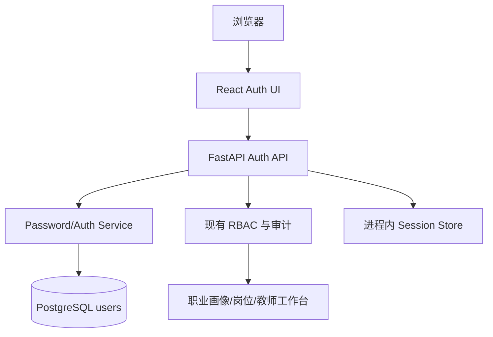

# 分角色账号登录架构设计

> **功能名称：** 职途智航分角色账号登录
> **版本：** v1.0
> **状态：** 审查中
> **关联需求：** `docs/specs/role-login-product.md`
> **最后更新：** 2026-09-09

## 1. 系统概览

前端新增统一登录/学生注册/改密页面，后端新增账号认证服务和管理员账号管理接口。用户表增加用户名、密码哈希、账号状态和首次改密标记；会话使用服务端内存中的随机 Bearer 令牌，角色从数据库用户记录解析后交给现有 RBAC。旧演示会话接口、固定演示身份和前端角色字段将被移除。

### 架构决策记录

| 决策 | 选择方案 | 被否定方案 | 理由 |
|:---|:---|:---|:---|
| 密码存储 | Python `hashlib.scrypt` + 每用户随机盐 | 明文、可逆加密、弱哈希 | 无需新增依赖且适合密码哈希 |
| 会话 | 随机不透明 Bearer 令牌，进程内 TTL 8 小时 | 前端自行携带角色、长期令牌 | 延续现有鉴权边界，避免泄露角色/密钥 |
| 注册 | 公开接口只能创建学生 | 客户端选择任意角色 | 防止自助注册获得教师/管理员权限 |
| 教师账号 | 管理员创建并生成一次性临时密码 | 教师自注册 | 维护学校人员边界 |
| 管理员首账号 | 环境变量/一次性运维命令初始化 | 网页注册 | 避免公开管理员入口 |
| 密码重置 | 管理员辅助一次性临时密码 | 仅凭用户名自助重置 | 当前无可信邮箱/短信恢复渠道 |

## 2. 组件拓扑图

## 3. 数据模型

在 `users` 表新增/调整：

| 字段 | 类型 | 约束 | 说明 |
|:---|:---|:---|:---|
| `username` | VARCHAR(64) | NOT NULL, UNIQUE | 规范化后唯一 |
| `password_hash` | TEXT | NOT NULL | scrypt 参数、盐和摘要的编码值 |
| `is_active` | BOOLEAN | NOT NULL, DEFAULT TRUE | 禁用账号不可登录 |
| `must_change_password` | BOOLEAN | NOT NULL, DEFAULT FALSE | 临时密码登录后强制改密 |
| `failed_login_count` | INTEGER | NOT NULL, DEFAULT 0 | 失败计数 |
| `locked_until` | TIMESTAMP | NULL | 基础锁定窗口 |
| `password_changed_at` | TIMESTAMP | NOT NULL | 密码变更时间 |

新增 `password_reset_tokens` 表：存储 token 哈希、目标用户、过期时间、使用时间和创建者；不存储原始 token。

## 4. API / 接口签名

### 4.1 登录

- `POST /api/v1/auth/login`，无认证。
- 请求：`{ "username": "string", "password": "string" }`
- 成功：`{ "access_token": "opaque", "token_type": "bearer", "expires_in": 28800, "role": "student|counselor|admin", "must_change_password": false }`
- 失败：统一 `401 INVALID_CREDENTIALS`；锁定账号同样不泄露状态。

### 4.2 学生注册

- `POST /api/v1/auth/register/student`，无认证。
- 请求：`{ "username": "string", "password": "string", "password_confirmation": "string", "display_name": "string" }`
- 成功：`201`，返回脱敏用户摘要；永不接受 `role` 字段。

### 4.3 修改密码

- `POST /api/v1/auth/change-password`，需认证，允许所有角色。
- 请求：`{ "current_password": "string", "new_password": "string", "password_confirmation": "string" }`
- 成功：`204`，撤销该用户现有会话并要求重新登录。

### 4.4 管理员创建/重置账号

- `POST /api/v1/admin/users/teachers`，需 `admin`；创建角色固定为 `counselor`，返回一次性临时密码。
- `POST /api/v1/admin/users/{user_id}/reset-password`，需 `admin`；仅允许学生或教师，返回一次性临时密码。
- `PATCH /api/v1/admin/users/{user_id}/status`，需 `admin`；仅允许启用/禁用学生或教师。

### 4.5 管理员初始化

- 提供后端一次性 CLI/启动脚本读取 `ADMIN_BOOTSTRAP_USERNAME` 与 `ADMIN_BOOTSTRAP_PASSWORD`。
- 缺少初始化参数不自动创建管理员；重复执行必须幂等且不能覆盖已有管理员密码。

## 5. 错误处理与安全策略

- 统一校验用户名格式、密码长度/字符规则和确认密码；错误响应不包含密码、哈希、盐或令牌。
- 连续失败达到阈值后短暂锁定；成功登录清零计数。认证事件写入现有审计服务。
- 改密、重置和禁用操作立即撤销目标用户会话。
- 管理员接口继续使用现有 `require_roles(UserRole.ADMIN)`；业务接口不接受客户端角色覆盖。
- 生产部署必须通过 HTTPS，并将初始化密码放入受控环境变量，使用后清理。

## 6. 性能考量

| 指标 | 目标值 | 测量方式 |
|:---|:---|:---|
| 登录接口 P95 | < 500 ms（不含故意延迟） | 后端集成测试 |
| 密码哈希 | 单次验证 < 300 ms | 本地基准测试 |
| 受保护接口 | 保持现有 P95 < 1 秒 | 回归测试 |

## 7. 审批记录

| 日期 | 审批人 | 决定 | 备注 |
|:---|:---|:---|:---|
| 2026-09-09 | — | 待批准 | 等待项目负责人确认 |
