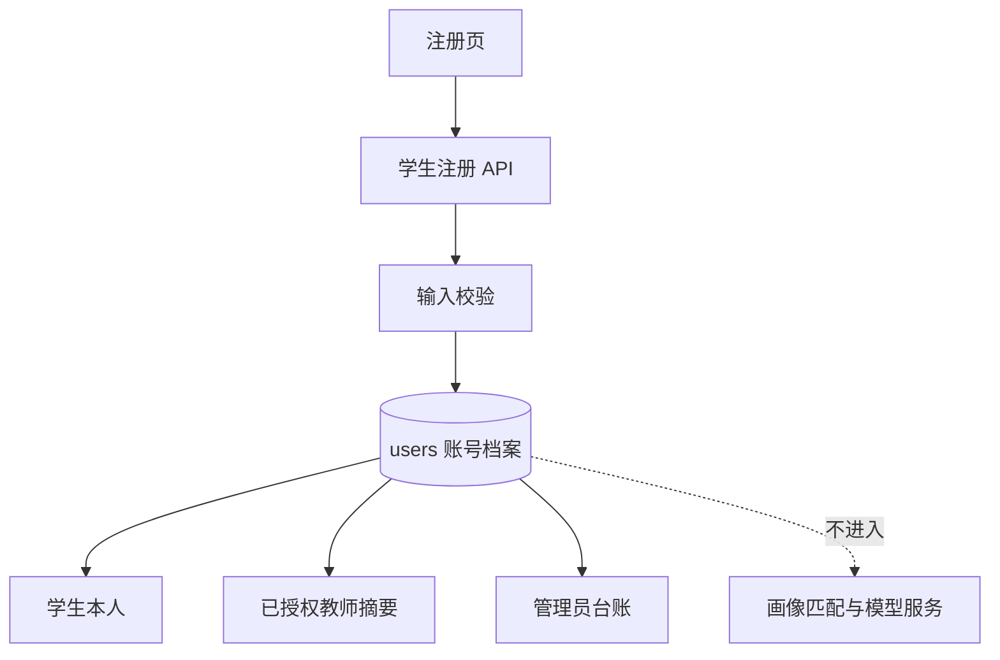

# 学生注册档案架构设计

> **功能名称：** 学生注册档案与入学年份选择
> **版本：** v1.0
> **状态：** 审查中
> **关联需求：** `docs/specs/student-account-profile-product.md`
> **最后更新：** 2026-09-09

## 1. 系统概览

在既有 `users` 账号表增加学生档案字段，并新增一个 Alembic revision。公开学生注册接口接收并校验这些字段；教师学生摘要和管理员台账在既有 RBAC 与教师授权关系下返回必要的联系字段。前端注册页以姓名取代显示名称，使用不新增依赖的滚动吸附年份选择器。

### 架构决策记录

| 决策 | 选择方案 | 被否定方案 | 理由 |
|:---|:---|:---|:---|
| 档案存储 | `users` 新增列 | 新建无权限边界的档案表 | 联系信息与账号一一对应，复用账号与 RBAC 边界 |
| 年份交互 | 原生滚动容器 + CSS scroll-snap | 日期输入、第三方 picker | 满足居中滚动交互且不新增依赖 |
| 联系信息使用 | 仅账号与授权工作台 | 匹配/模型上下文 | 与就业决策数据隔离，降低隐私暴露 |

## 2. 组件拓扑图



## 3. 数据模型

在 `users` 表新增：

| 字段 | 类型 | 约束 | 说明 |
|:---|:---|:---|:---|
| `student_number` | VARCHAR(10) | NULL, UNIQUE, 10 位数字 | 仅学生注册时写入；迁移前教师/管理员历史账号可为空 |
| `phone` | VARCHAR(32) | NULL | 中国大陆手机号码 |
| `email` | VARCHAR(254) | NULL | 联系邮箱 |
| `enrollment_year` | INTEGER | NULL, CHECK 1958 <= value <= current year at API validation | 入学年份 |

新建学生账号时上述列全部非空；数据库保留 NULL 以兼容历史教师、管理员和迁移后的旧账号。`display_name` 继续保存姓名。

## 4. API / 接口签名

### 4.1 学生注册

| 属性 | 值 |
|:---|:---|
| 方法 | `POST` |
| 路径 | `/api/v1/auth/register/student` |
| 认证 | 无 |
| 权限 | 仅创建 `student` |

请求：

```json
{
  "username": "student-a",
  "password": "SecurePass9",
  "password_confirmation": "SecurePass9",
  "name": "张三",
  "student_number": "20260001",
  "phone": "13800138000",
  "email": "zhangsan@example.edu.cn",
  "enrollment_year": 2026
}
```

成功 `201` 返回脱敏账号摘要：`id`、`username`、`display_name`、`role`、`must_change_password`。不得在公开注册响应回显电话和邮箱。

错误：`409` 学号或用户名已使用；`422` 字段格式或范围不合法。

### 4.2 教师与管理员读取

既有 `/api/v1/staff/counselor/students` 与 `/api/v1/staff/admin/overview` 扩展学生档案字段。教师接口仅返回已授权学生；管理员接口继续要求 `admin` 角色。

## 5. 依赖白名单

| 依赖 | 用途 | 是否新增 |
|:---|:---|:---|
| FastAPI / Pydantic | API 与字段校验 | 否 |
| SQLAlchemy / Alembic | ORM 与迁移 | 否 |
| React / TypeScript / CSS | 表单与年份滚动控件 | 否 |

## 6. 错误处理策略

| 场景 | 处理 | 用户感知 |
|:---|:---|:---|
| 学号重复 | `409`，不创建账号 | “学号已被使用” |
| 用户名重复 | `409`，不创建账号 | “用户名已被使用” |
| 电话/邮箱/年份非法 | `422` 字段错误 | 可读字段级错误 |
| 未授权教师读取 | 维持既有授权过滤/403 | 不泄露联系信息 |

## 7. 安全策略

- 输入验证在服务端执行，前端校验仅用于即时反馈。
- 学号必须为 10 位数字，唯一约束由数据库保证；电话与邮箱不建立唯一约束。
- 联系字段只能在学生本人、已授权教师和管理员的响应模型中出现。
- 审计继续只记录白名单动作与资源标识，不记录联系字段或注册请求体。
- 更新 `docs/data-governance/` 与隐私回归测试，明确该授权场景是对原演示数据禁止项的受控例外。

## 8. 审批记录

| 日期 | 审批人 | 决定 | 备注 |
|:---|:---|:---|:---|
| 2026-09-09 | — | 待批准 | 等待项目负责人确认 |
