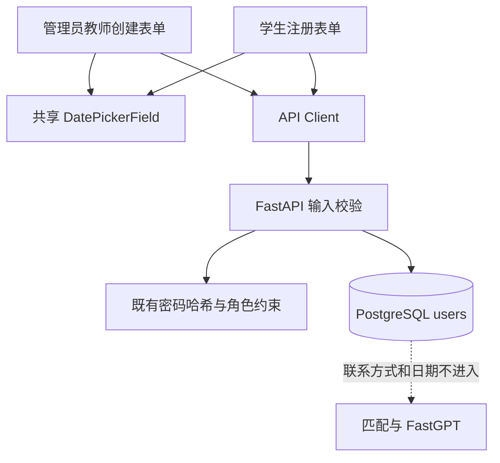

# 教师账号资料与统一日期选择架构设计

> **功能名称：** 教师账号完整资料与学生/教师日期选择
> **版本：** v1.0
> **状态：** 审查中
> **关联需求：** `docs/specs/teacher-account-date-profile-product.md`
> **最后更新：** 2026-09-14

## 1. 系统概览

在现有 `users` 账号表增加两个可空日期列：`employment_date` 与 `enrollment_date`。教师创建接口扩展为接收管理员填写的六项资料，复用现有用户名、手机号、邮箱和密码校验逻辑；学生注册接口由年份输入调整为完整日期输入，同时保留并维护 `enrollment_year` 兼容字段。前端抽取共享 `DatePickerField`，在管理员教师表单和学生注册表单中复用原生 `input[type=date]`。

### 架构决策记录

| 决策 | 选择方案 | 被否定方案 | 理由 |
|:---|:---|:---|:---|
| 日期存储 | PostgreSQL `DATE` | 字符串、时间戳 | 只表达自然日期，不引入时区偏移 |
| 旧学生兼容 | 保留 `enrollment_year`，新数据同时派生写入 | 将旧年份统一回填为某月某日 | 避免制造不存在的历史日期 |
| 日期交互 | 共享原生日期输入组件 | 继续年份滚轮、引入第三方日期库 | 原生即可弹出日历小卡片，依赖最少且可访问性更稳定 |
| 教师密码 | 管理员提交初始密码，服务端哈希并要求首次修改 | 服务端返回临时明文密码 | 满足指定表单字段并减少响应中的敏感信息 |
| 教师身份 | 映射到 `display_name` | 新增重复姓名列 | 维持现有登录会话、台账和授权显示合同 |

## 2. 组件拓扑



## 3. 数据模型

`users` 表新增：

| 字段名 | 类型 | 约束 | 描述 |
|:---|:---|:---|:---|
| `employment_date` | `DATE` | NULL | 教师入职日期；新教师创建时必填，历史账号可空 |
| `enrollment_date` | `DATE` | NULL | 学生入学日期；新学生注册时必填，历史账号可空 |

继续保留：

| 字段名 | 兼容规则 |
|:---|:---|
| `display_name` | 学生姓名或教师身份名称 |
| `phone` / `email` | 学生和教师均可使用，历史账号允许 NULL |
| `enrollment_year` | 新注册时取 `enrollment_date.year`；旧数据保持原值 |

迁移只增加可空列，不修改或回填旧行，因此可在现有 PostgreSQL 数据上无损升级。

## 4. API / 接口签名

### 4.1 管理员创建教师

| 属性 | 值 |
|:---|:---|
| 方法 | `POST` |
| 路径 | `/api/v1/admin/users/teachers` |
| 认证 | 必需 |
| 权限 | `admin` |

请求：

```json
{
  "username": "teacher.zhang",
  "display_name": "张老师",
  "phone": "13800138000",
  "email": "zhang@example.edu.cn",
  "employment_date": "2026-09-01",
  "password": "SecurePass9"
}
```

成功 `201` 返回既有非敏感 `UserSummary`；不返回请求密码、密码哈希或临时密码。账号 `role` 固定为 `counselor`，`must_change_password` 为 `true`。

错误：用户名重复为 `409`；字段格式、未来日期或弱密码为 `422`；非管理员为 `403`。

### 4.2 学生注册

`POST /api/v1/auth/register/student` 将请求字段 `enrollment_year` 替换为：

```json
{
  "enrollment_date": "2026-09-01"
}
```

服务端校验日期范围后写入 `enrollment_date`，并同步写入 `enrollment_year = 2026`。公开响应继续不回显电话、邮箱或日期。

### 4.3 工作台读取

- 教师授权学生摘要和管理员学生台账增加可空 `enrollment_date`；前端优先显示完整日期，否则回退显示 `enrollment_year`。
- 管理员教师列表可增加可空 `phone`、`email`、`employment_date`，仅在管理员接口返回。
- 不扩大普通教师对其他教师资料的读取范围。

## 5. 前端设计

新增共享组件 `frontend/src/components/DatePickerField.tsx`：

- 使用 `input type="date"`，值与回调统一为 `YYYY-MM-DD` 字符串。
- 支持 `label`、`value`、`onChange`、`min`、`max`、`required`、`disabled`、`id` 参数。
- 使用项目已有 `lucide-react` 日历图标；点击控件使用浏览器原生日历，不自绘浮层。
- 教师表单和学生注册表单使用同一组件、同一高度、边框、焦点和错误状态。
- `max` 每次渲染取本地当天，`min` 为 `1958-01-01`。

## 6. 依赖白名单

| 依赖 | 用途 | 是否新增 |
|:---|:---|:---|
| FastAPI / Pydantic | 输入与日期校验 | 否 |
| SQLAlchemy / Alembic | `DATE` 列与迁移 | 否 |
| React / TypeScript | 表单状态和共享组件 | 否 |
| lucide-react | 日期字段图标 | 否 |

## 7. 错误处理策略

| 场景 | 处理方式 | 用户感知 |
|:---|:---|:---|
| 字段缺失或非法 | 服务端 `422`，前端保留表单值 | 显示可读提示，不清空已填内容 |
| 用户名重复 | 服务端 `409` | “用户名已被使用” |
| 日期晚于当天 | 服务端 `422` | “日期不能晚于今天” |
| 教师创建成功 | 刷新台账并清空创建表单 | “教师账号已创建” |
| 网络失败 | 不创建本地假数据 | “操作未完成，请稍后重试” |

## 8. 安全策略

- 复用现有 `validate_password` 和 `hash_password`；请求密码不得写入日志、审计和响应。
- 教师创建仍由 `AdminPrincipal` 保护，角色由服务端固定。
- 联系信息和日期不得进入岗位匹配、FastGPT、画像文本或审计 metadata。
- 前端 `required/min/max` 只改善交互，服务端 Pydantic 校验是最终边界。
- 迁移新增字段允许 NULL，以兼容历史教师、管理员和学生账号。

## 9. 性能考量

本功能只增加常量级字段校验与同表写入，不新增远程调用。单次注册/创建接口的性能目标维持现有水平；日期选择组件不加载第三方资源。

## 10. 审批记录

| 日期 | 审批人 | 决定 | 备注 |
|:---|:---|:---|:---|
| 2026-09-14 | — | 待批准 | 等待项目负责人确认 |

